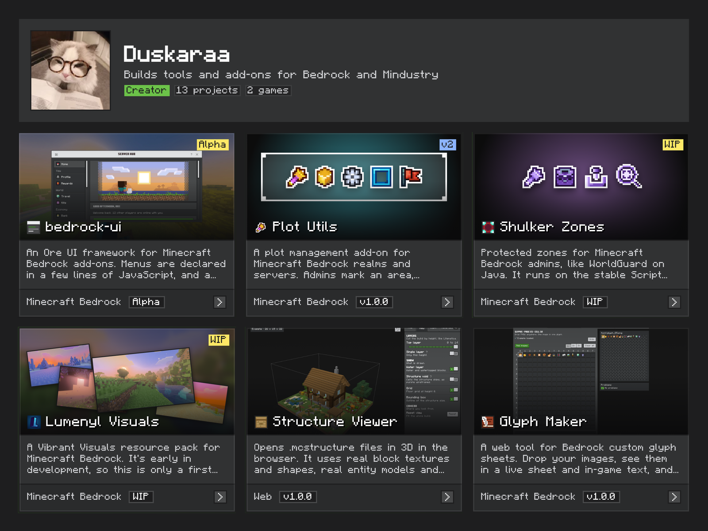

# Duskaraa

Portfolio of Duskaraa, a Minecraft Bedrock developer. Add-ons, UI frameworks and web tools for creators, plus a few Mindustry projects.

**Visit:** https://duskaraa.github.io/

## Web tools

- [Nineslice Editor](https://duskaraa.github.io/nineslice-editor/)
- [Structure Viewer](https://duskaraa.github.io/structure-viewer/)
- [Manifest Builder](https://duskaraa.github.io/manifest-builder/)
- [Recipe Builder](https://duskaraa.github.io/recipe-builder/)
- [Glyph Maker](https://duskaraa.github.io/glyph-maker/)

## About

The site is built with React and Vite in a Minecraft Ore UI style. This repository holds only the built site.

Not an official Minecraft product. Not approved by or associated with Mojang or Microsoft.

## License

[MIT](LICENSE). Minecraft textures, fonts and screenshots belong to Mojang and are not covered by this license.
